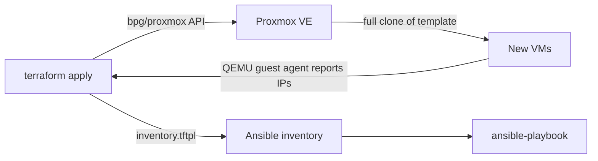

# Proxmox Terraform VM Provisioning

Provision Ubuntu VMs on Proxmox VE from a cloud-init template with Terraform.
VMs are defined in one map, sized with simple profiles, and an Ansible inventory
is generated automatically so they can be configured straight after creation.

## How it works



1. **Define VMs.** You describe each VM (ID, name, profile) in a `vms` map in your tfvars file.
2. **Validate.** Terraform checks the input at plan time (see [Validation](#validation)).
3. **Clone.** Each VM is a full clone of a cloud-init template, sized by its profile.
4. **Configure on first boot.** Cloud-init creates an `ansible` user with your SSH public key and sets up DHCP.
5. **Discover IPs.** The QEMU guest agent reports each VM's IP address back to Terraform.
6. **Generate inventory.** The IPs are rendered into an Ansible inventory file using `inventory.tftpl`.
7. **Configure with Ansible.** Run your playbooks against the generated inventory.

## Features

- VMs defined in a single `vms` map using `for_each`
- Size profiles: `small`, `medium`, `large`
- Full clones from a cloud-init template, DHCP networking, QEMU guest agent
- Auto-generated Ansible inventory from the discovered IPs
- Input validation that fails at `terraform plan`, before anything touches Proxmox
- Secrets and state kept out of version control

## Project structure

```
.
├── README.md
├── versions.tf               # Terraform and provider version constraints
├── providers.tf              # Proxmox provider configuration
├── variables.tf              # Inputs, with validation
├── locals.tf                 # VM size profiles
├── main.tf                   # The VM resource
├── outputs.tf                # IP map, inventory file, outputs and checks
├── inventory.tftpl           # Ansible inventory template
├── terraform.tfvars.example  # Example input values (copy and edit)
└── docs/
    └── template-setup.md     # How to build the cloud-init template
```

## Prerequisites

- Proxmox VE with an API token that can create and clone VMs
- A cloud-init VM template (see [docs/template-setup.md](docs/template-setup.md))
  with the QEMU guest agent installed
- Terraform >= 1.7
- An SSH key pair for the `ansible` user

## Usage

```bash
cp terraform.tfvars.example terraform.tfvars   # edit with your values
terraform init
terraform plan
terraform apply
```

After `apply`, Terraform prints the VM IPs and writes the Ansible inventory.
Test it with:

```bash
ansible -i <inventory-file> targets -m ping
```

To remove everything: `terraform destroy`.

## Configuration

Copy `terraform.tfvars.example` and edit it. Main inputs:

| Variable | Description | Default |
|----------|-------------|---------|
| `target_machine` | Proxmox API URL, e.g. `https://192.168.0.10:8006/` | required |
| `api_token` | Proxmox API token (sensitive) | required |
| `node_name` | Proxmox node to deploy to | required |
| `clone_target` | VM ID of the cloud-init template, e.g. `9000` | required |
| `ansible_public_key` | SSH public key for the `ansible` user | required |
| `vms` | Map of VMs to create | required |
| `insecure_tls` | Skip TLS verification (self-signed cert) | `true` |
| `datastore_id` | Datastore for disks and cloud-init | `local-lvm` |
| `bridge` | Network bridge | `vmbr0` |
| `inventory_path` | Where to write the Ansible inventory | `generated/terraform_inventory.ini` |

Example `vms` value:

```hcl
vms = {
  web = { vm_id = 301, name = "web-01", profile = "small" }
  db  = { vm_id = 302, name = "db-01",  profile = "large" }
}
```

## VM profiles

| Profile | vCPU | RAM  | Disk  |
|---------|------|------|-------|
| small   | 1    | 2 GB | 6 GB  |
| medium  | 2    | 4 GB | 12 GB |
| large   | 4    | 8 GB | 18 GB |

Profiles are defined in `locals.tf`. Add or change them there.

## Validation

Bad input fails at `terraform plan`, before anything touches Proxmox:

- VM IDs are 100 or higher and unique
- VM names are unique, valid lowercase hostnames
- Each profile must be `small`, `medium` or `large`
- The SSH public key must be in a valid OpenSSH format

A `check` block also warns if a VM has no IP yet, which usually means the
guest agent is not running in the template.

## Ansible integration

The generated inventory looks like this:

```ini
[terraform_vms]
web-01 ansible_host=192.168.0.31
db-01 ansible_host=192.168.0.32

[terraform_vms:vars]
ansible_user=ansible

[targets:children]
terraform_vms
```

Point Ansible at it (via `-i` or `inventory =` in `ansible.cfg`) and run your playbooks against the `targets` group.

## Security notes

- `*.tfvars`, `*.tfstate` and generated inventories are gitignored
- The API token is marked `sensitive` and never committed
- Use a dedicated Proxmox API token with only the permissions it needs
- `insecure_tls = true` is for self-signed homelab certificates; set it to
  `false` if your Proxmox certificate is trusted

## Roadmap

- Remote state backend
- Convert the VM resource into a reusable module
- CI for `terraform fmt`, `validate` and tests